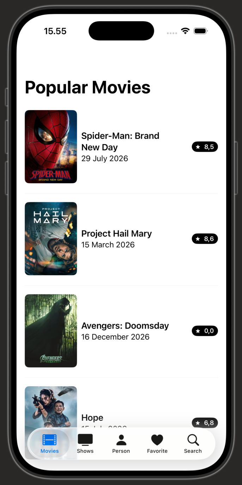
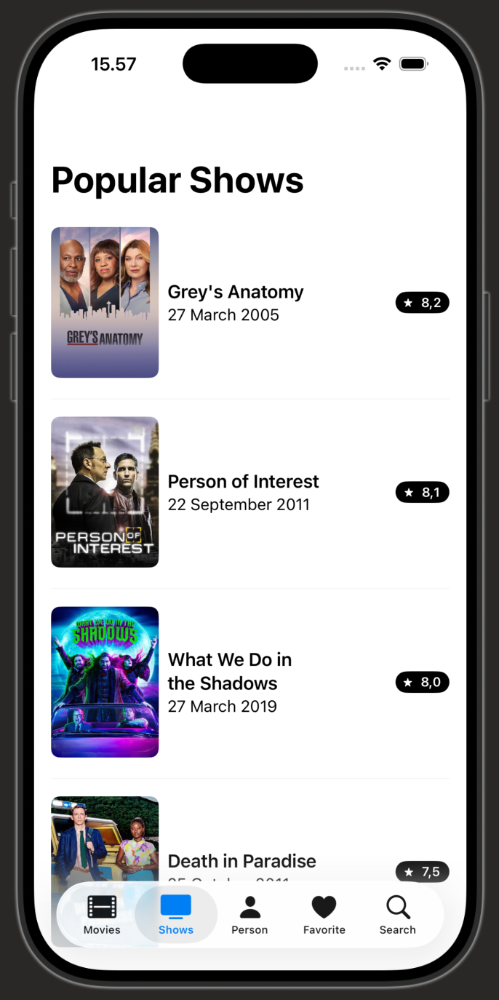
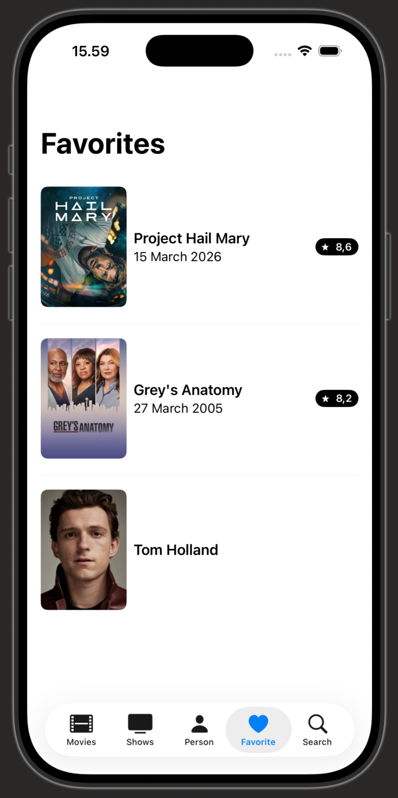
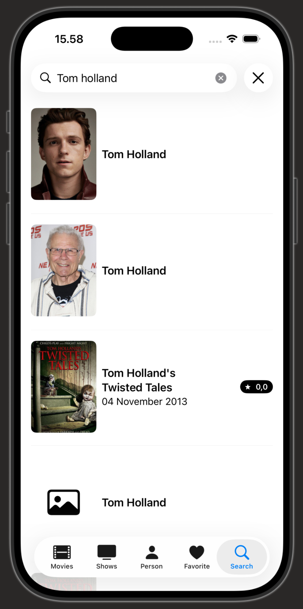
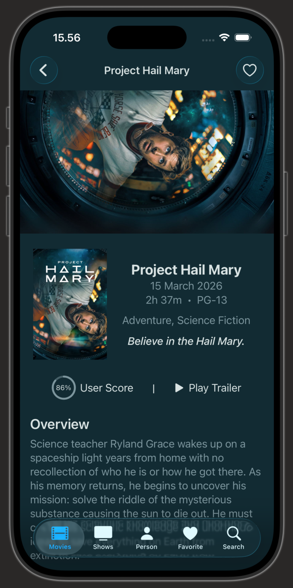
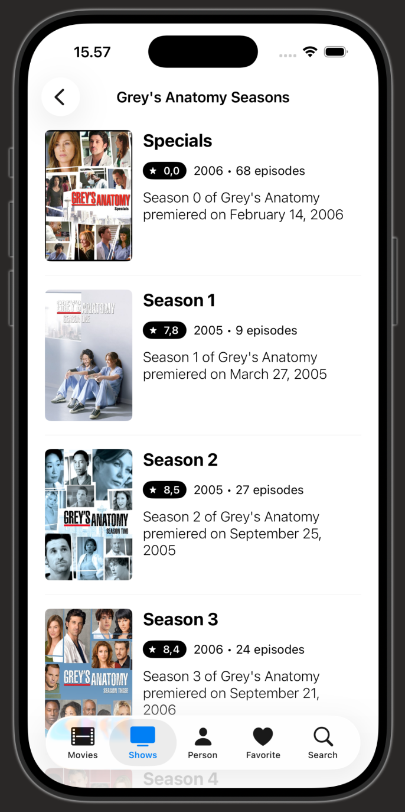
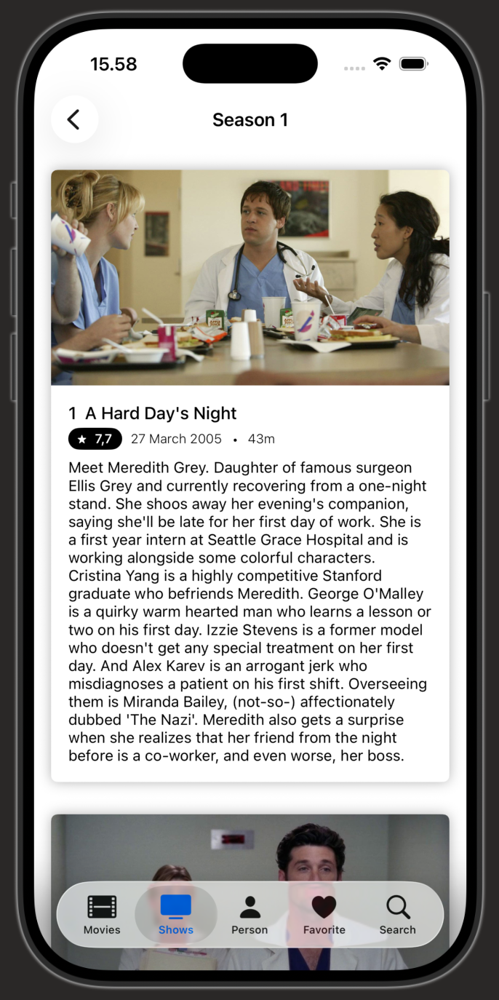
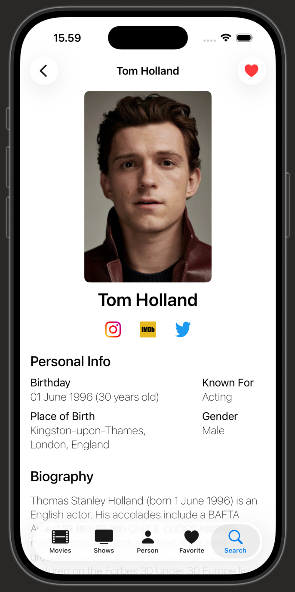

# TMDb

TMDb is a SwiftUI iOS application for browsing movies, TV shows, and people from The Movie Database (TMDb). The app includes search, detail screens, favorite management, and a clean modular architecture built for iOS.

## Features

- Browse popular and latest movies
- Explore TV shows and episodes
- View detailed information for movies, TV shows, and cast members
- Search content by keyword
- Save favorite items locally
- Native iOS interface built with SwiftUI
- Clean architecture using repositories, use cases, and coordinators-like routing layers

## Screenshots

<div align="center">

<table>
  <tr>
    <td align="center">
      <br>
      <sub>Movie list</sub>
    </td>
    <td align="center">
      <br>
      <sub>TV list</sub>
    </td>
    <td align="center">
      <br>
      <sub>Favorites</sub>
    </td>
  </tr>
  <tr>
    <td align="center">
      <br>
      <sub>Search</sub>
    </td>
    <td align="center">
      <br>
      <sub>TV detail</sub>
    </td>
    <td align="center">
      <br>
      <sub>Seasons</sub>
    </td>
  </tr>
  <tr>
    <td align="center">
      <br>
      <sub>Episodes</sub>
    </td>
    <td align="center">
      <br>
      <sub>Person detail</sub>
    </td>
    <td align="center">
      <br>
      <sub>Movie detail</sub>
    </td>
  </tr>
</table>

</div>

## Tech Stack

- SwiftUI
- Swift
- TMDb API
- Alamofire
- SwiftData

## Project Structure

```text
TMDb/
├── App/
│   ├── TMDbApp.swift
│   ├── ContentView.swift
│   ├── SplashView.swift
│   └── LaunchScreen.storyboard
├── Core/
│   ├── CustomView/
│   ├── DI/
│   ├── Data/
│   ├── Domain/
│   └── Utils/
├── Module/
│   ├── Movie/
│   ├── TvShow/
│   ├── Search/
│   ├── Favorite/
│   ├── Person/
│   └── Detail/
├── Assets.xcassets/
├── Info.plist
├── .swiftlint.yml
├── .gitattributes
├── TMDb.xcodeproj/
└── README.md
```

## Getting Started

### Requirements

- Xcode 15 or later
- iOS 17+ recommended
- A macOS machine with Xcode installed

### Run the app

1. Clone the repository:

```bash
git clone https://github.com/aldidwiki/TMDb.git
```

2. Open `TMDb.xcodeproj` in Xcode.
3. Select a simulator or connected device.
4. Build and run the project.

## API Configuration

This project uses the TMDb API for movie and show data. The base configuration is located in:

- `TMDb/Core/Utils/API.swift`

The app currently includes an authorization token in the project. If the token expires or you want to use your own TMDb API access, update the `headers` or authentication logic in that file.

## Notes

- The project follows a modular SwiftUI architecture with separate feature folders for movies, TV shows, search, favorites, and detail views.
- Favorite data is persisted locally using SwiftData.
- Assets and styling are organized under `Assets.xcassets` and custom reusable view components live under `Core/CustomView`.

## License

This project does not currently include a license file. If you plan to distribute or reuse it publicly, consider adding an appropriate license such as MIT.

## Contributing

Pull requests and improvements are welcome. If you want to extend or fix the app, consider updating the relevant feature module and validating the app in Xcode.
